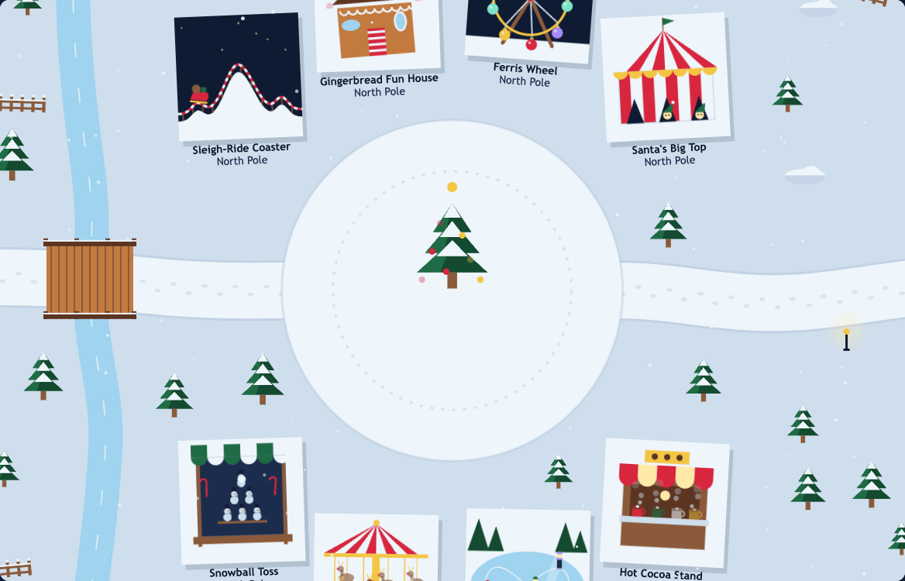

<h1 align="center">Carnival Factory – Christmas edition</h1>

  <strong>A Christmas carnival that a software factory builds, one booth at a time.</strong> 
  Describe your booth in an issue. An agent builds it, checks it and opens the pull request.

<h3 align="center">
  <a href="https://ainativedev.github.io/Northpole-Carnival-Factory/">ainativedev.github.io/Northpole-Carnival-Factory</a>
</h3>

  
  
  
  

  

Every square on this map was built by a software factory. A ferris wheel, a
reindeer carousel and a hot cocoa stand stand round the town square, and along
the lanes every participant owns one square of their own, their **booth**.
Nobody writes the code by hand: you describe what you want in an issue, an
agent checks the request, builds it and opens a pull request with a preview,
and code review checks it before it lands on the map.

Each booth runs sandboxed in its own frame, so the worst a booth can do is
break itself, and a booth can react to the mouse or a tap, so it can be
something people play with, not just watch.

## Get a booth

1. **Ask for it.** Open **Issues → New issue → Your booth** and say what your
   booth should show, and its name. You can attach a picture, such as your logo
   or a sketch.
2. **The factory checks it.** An agent reads your request first. If it's
   clear, the factory builds it; if not, it asks you a question: edit the issue
   to answer.
3. **Watch it being built.** A **Being built** sign stands on your spot on the
   map while the factory works. It opens a pull request linked from your
   issue, with a **Preview** link to the whole map with your booth on it.
4. **It's on the map.** Once it merges, your booth is at
   `…/#/booth/<your-login>`, and its page shows how it was built, step by step.
5. **Share it.** Your booth's page has **Share**, with a link that opens the
   map in front of your booth: `…/#/?booth=<your-login>`.
6. **Change it** whenever you like: open **Your booth** again. Your latest
   request is the one that counts.

**Want a whole place of your own?** Once you have a booth, open **Your level**
for a level: a patch of the North Pole laid out how you like, with up to 8
squares, that visitors reach by sleigh. Levels unlock after a booth. [Level ideas](docs/level-ideas.md) and
[booth ideas](docs/booth-ideas.md) help you write the request.
[How your request is built](docs/how-it-works.md) explains every step.

## Vote for your favourite

Every booth has a comment on the pinned **People's Choice** issue, and a 👍 on
it is a vote: a booth's page links to it with **Vote for this booth**. One vote
per GitHub account, and your vote for your own booth doesn't count. Voting
closes at the end of 31 December 2026 (UTC), and the top three get a trophy on
their sign.

## Feedback and ideas

We love kudos and ideas. Open **Issues → New issue → Feedback on the factory**
or **An idea**: they stay open, and the maintainers read every one.

Looking back on the year? The **Year in Review** gallery at the North Pole asks
13 questions about AI in '26 and '27: answer one, or ask your own, with
**Issues → New issue → Year in review**. Friendly answers hang in the room
after the next update of the map.

## The rules of the map

- **Your booth is yours alone.** A change for you only ever touches your own
  booth or level.
- **Issues, not pull requests.** Every change starts as an issue; a pull request
  from outside is closed with a pointer to the forms.
- **A booth can't break the map.** Every booth runs sandboxed, with no network,
  storage or access to the page. One that breaks shows "Under construction",
  and everything else keeps running.
- **A booth only draws.** House rules and code review keep it to drawing.
- **The attractions belong to the North Pole**, and only maintainers change
  them.

## Run your own

Want a Carnival Factory of your own, with you as the maintainer?
[RUN-YOUR-OWN.md](RUN-YOUR-OWN.md) has the steps to fork and set it up.

It's based on [Tessl Carnival](https://github.com/tesslio/tessl-carnival), the
starter repo for the "Build your own software factory with context" workshop.

## License

MIT. See [`LICENSE`](LICENSE).
